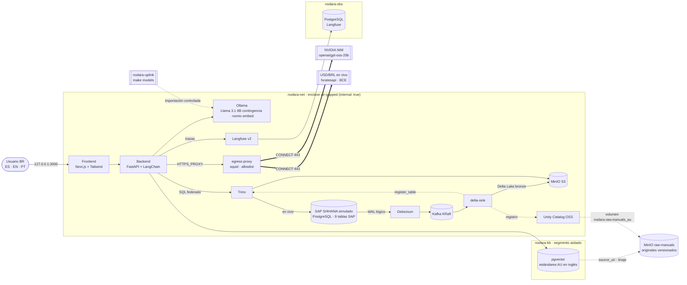

# Nodara BR-RAG

**Real-Time AI Lakehouse air-gapped para Inteligencia Operacional en minería multinacional (Australia → Brasil).**

El usuario pregunta en **español, inglés o portugués** y elige el motor de IA: **NVIDIA NIM (Cloud)** u
**Ollama (Local)**. El sistema recupera los estándares corporativos de Australia (en inglés, pgvector) y los **cruza en
tiempo real con SAP S/4HANA Brasil** vía Trino: crédito con tipo de cambio en vivo, mantenimiento y stock. Después
responde **exactamente en el idioma elegido** y cita el manual y las transacciones SAP que aplican.

El enclave no tiene salida a Internet. La única excepción es un gateway con allowlist hacia NVIDIA y las APIs de tipo
de cambio. Cada pregunta queda trazada en Langfuse, autoalojado.

| Indicador (validado con `make smoke` y `make ui-test`) | Resultado |
|---|---|
| Servicios del stack | 14 servicios `healthy` + 2 jobs de inicialización `exit 0` (`make up` espera a que estén listos) |
| Casos C-Level | 3 casos sembrados y respondidos E2E (Compliance en ES, Lixiviación en EN, Flotación en PT) con NIM, más la contingencia local |
| Motor NIM (`openai/gpt-oss-20b` vía gateway) | 14,6–20,9 s por respuesta con el endpoint de NVIDIA estable y 23–42 s cuando está congestionado ([TD-033](TECH_DEBT.md)); sin caer a la contingencia; cita XD01, IW31 y MIGO |
| Contingencia local (Llama 3.1 8B en GPU GTX 1070 Ti) | 18,9–22,6 s por respuesta (medido en `make smoke`) |
| Observabilidad | 1 traza por pregunta en Langfuse con `userId` `operador_br@nodara.com`, generaciones LLM y spans de retrieval y SAP |
| Tipo de cambio | ACDOCA convertida con `TCURR` a la fecha de contabilización + USD/BRL en vivo (fxratesapi → BCE); sin tasas fijas |
| Ruteo de idioma | Respuesta en el idioma solicitado (verificado por detector) · UI y metadatos ES/EN/PT con render en servidor (Playwright) |
| Latencia CDC S/4 → Delta Lake (commit fuente → commit Delta) | 1–6 s medidos (micro-batch de 5 s, `FLUSH_INTERVAL_S`) |
| Raw layer (gobierno de datos) | originales versionados en `raw-manuals`, integridad SHA-256 y linaje índice ⊆ raw verificados |
| Air-gap y egress | Ollama, backend, delta-sink y Kafka sin salida directa; el backend sale solo por el gateway (3 dominios); `pypi.org` y `example.com` denegados |
| Idempotencia | `make smoke` y `make demo` re-siembran antes de correr: el stock de xantato siempre parte del seed |
| Colisiones de puertos | 0 (`make preflight` revisa Linux/WSL y Windows) |

## Casos de negocio C-Level (seed estricto)

| Caso | Estándar corporativo AU (raw layer + pgvector) | Datos SAP S/4HANA Brasil (en vivo vía Trino) | Transacción |
|---|---|---|---|
| **1 · Compliance** | *Global KYC & Counterparty Onboarding Standard* (`AU-CMP-KYC-001`): formulario W-8BEN/W-8BEN-E, validación AML, límites de crédito, Anexo BR | Refinaria Atlântico Sul S.A. **bloqueada** en gestión de crédito: límite USD 5.000.000, exposición USD 5.420.000 (108,4 %), USD 3.450.000 vencidos; CNPJ e Inscrição Estadual registrados; exposición revaluada en BRL con FX en vivo frente a lo contabilizado (`TCURR`) | **XD01** (CNPJ e IE obligatorios) |
| **2 · Lixiviación** | *SOP: PLS Flow Optimization & Acid Pump Maintenance* (`AU-LIX-SOP-002`): concentración de ácido, desarme de bomba centrífuga, inspección post-tormenta | Bomba PB-LIX-02 caída por **tormenta tropical** (aviso M2); **orden 4000200101 ya creada** y liberada en CC-LIX-01; repuesto **SKU-BR-ACID-9902 reservado con stock 0** | **IW31** (verificar antes en IW38) |
| **3 · Flotación** | *Global Reagent Dosage Strategy for Variable Grade Ore* (`AU-FLO-STR-003`): dosis de 15 g/t por caída de ley, cobertura mínima de 14 días | Xantato **SKU-BR-REAG-4410** en el **Depósito 002** (BR10/0002), consumo diario contabilizado con MIGO (~400 kg/día a 10 g/t) | **MIGO** (movimiento 201) |

Modelo SAP fiel, sin atajos: `BUT000`, `UKMBP_CMS_SGM` (crédito FSCM), `DFKKBPTAXNUM` (CNPJ/IE), `MATDOC`
(con `TCODE2`), `ACDOCA` (partidas abiertas de cliente, cuadrado por documento), `TCURR` (tipos de cambio M; las
partidas en USD se convierten a BRL con la tasa vigente a la fecha de contabilización), `QMEL`/`AUFK` (avisos y
órdenes PM) y `RESB` (reservas). El simulador `sap.simulate_activity(n)` solo genera consumo de xantato por turno, de
modo que los casos 1 y 2 nunca cambian.

## Arquitectura



| Capa | Componente | Versión | Host (127.0.0.1) |
|---|---|---|---|
| Transaccional | SAP S/4HANA simulado: PostgreSQL relacional con 9 tablas SAP (esquema `sap`) | postgres 16.15 | `S4_DB_PORT` (5432) |
| CDC | Debezium Connect (pgoutput) + Kafka KRaft | 3.6.3 / 4.3.2 | Debezium REST 8083 |
| Lakehouse | MinIO (S3: `lakehouse` + `raw-manuals`) + Delta Lake (delta-rs) + Unity Catalog OSS + Trino | 2026-08 / 1.6 / 0.7.0 / 484 | MinIO 9000/9001 · UC 8081 · Trino 8080 |
| Conocimiento | PostgreSQL + pgvector aislado (solo manuales) | pgvector 0.8.7 | 5433 |
| IA y backend | FastAPI + LangChain 0.3 → NVIDIA NIM (`openai/gpt-oss-20b`) con contingencia Ollama (Llama 3.1 8B); embeddings locales `nomic-embed-text` | langchain-nvidia 0.3.19 · Ollama 0.40.11 | no publicado (air-gap) |
| Salida controlada | Gateway squid: default deny, solo CONNECT 443 a `egress/allowlist.txt` | squid 6.6 | no publicado |
| Observabilidad GenAI | Langfuse v2 autoalojado (SDK v2 + `CallbackHandler`) + PostgreSQL | 2.95.11 / SDK 2.60.10 | 3001 |
| Frontend | Next.js + TailwindCSS (consola ES/EN/PT, selector de motor, paneles SAP de crédito, PM y stock) | Next 16.4 · Tailwind 4.3 | 3000 |

### Flujo de una pregunta (motor y ruteo de idioma)

1. La UI envía `{"question": "...", "language": "ES|EN|PT", "engine": "nim|ollama"}`. La API también acepta `query`
   como alias de `question`, y `nvidia`/`cloud` o `local` como alias del motor.
2. Se abre una traza de Langfuse con `user_id` = `TRACE_USER_ID`. Si la pregunta no está en inglés, el motor elegido
   la traduce al inglés técnico; `nomic-embed-text` (local) la vectoriza.
3. pgvector (HNSW, coseno) identifica el estándar relevante, que entra **completo** al contexto (*small-to-big*).
   Así las secciones con transacciones SAP y anexos BR nunca quedan fuera.
4. Trino resuelve en vivo las entidades SAP curadas para ese estándar (`knowledge/kb-curation.json`):
   - crédito de contrapartes, con exceso sobre el límite y revaluación en BRL (FX en vivo frente a `TCURR`);
   - órdenes y avisos PM del centro de costo;
   - stock, cobertura a la tasa actual, reservas y movimientos de los materiales.
5. El LLM redacta la respuesta con un *system prompt* **en el idioma solicitado**, en formato ejecutivo de hasta
   220 palabras: situación en SAP, qué exige el manual, próximos pasos con transacción y fuentes.
6. Antes de responder actúan dos controles deterministas:
   - **control de idioma**: detecta el idioma y, si se desvió, re-traduce;
   - **control de transacciones**: neutraliza cualquier código SAP que no esté en los manuales ni en los datos, y devuelve las transacciones prescritas por el estándar (`grounding_check.declared`).
7. La respuesta trae sus metadatos: motor y modelo usados (`model_used`), intentos (`attempts`), `trace_id`/`trace_url`
   y tiempos por etapa. La UI los muestra traducidos al idioma elegido.

### Motores de IA y contingencia

- **NVIDIA NIM (por defecto)**: `ChatNVIDIA` contra `integrate.api.nvidia.com`, siempre a través de `egress-proxy`.
  Modelo `NIM_MODEL` (por defecto `openai/gpt-oss-20b`, `reasoning_effort=low`).
- **Contingencia**: si un intento falla o supera `NIM_TIMEOUT_S` (45 s), la misma pregunta sigue con Ollama local. La
  respuesta lo indica (`model_used`, `attempts`) y la UI lo marca como contingencia.
- **Ollama (local)**: Llama 3.1 8B dentro del enclave; con este motor ningún dato sale del enclave. Los embeddings
  siempre son locales. Sin `NVIDIA_API_KEY`, la UI desactiva NIM y todo corre en local.
- **Modelo solicitado vs. disponible**: la especificación pedía Llama 3.1 70B Instruct. En la API de NVIDIA,
  `meta/llama-3.1-70b-instruct` y `meta/llama-3.3-70b-instruct` responden 410 (EOL 2026-08-26), y
  `meta-llama/llama-3.1-70b-instruct` responde 404. El valor por defecto es `openai/gpt-oss-20b`
  ([TD-025](TECH_DEBT.md)). Para cambiarlo basta con `NIM_MODEL` en `.env`; `make smoke` verifica que esté habilitado
  para la cuenta.
- **Residencia de datos**: con NIM, la pregunta y su contexto (estándares y datos SAP) salen hacia NVIDIA. Para datos
  sensibles usar el motor Ollama ([TD-026](TECH_DEBT.md)).

### Pipeline en tiempo real

`S/4 (WAL) → Debezium → Kafka (s4hana.sap.*) → delta-sink → s3://lakehouse/bronze/<tabla>` es Delta append-only, con
las columnas `_cdc_op`, `_source_ts`, `_source_lsn` e `_ingested_at`. Cada tabla publicada se registra sola en Trino
(`lakehouse.bronze.*`) y en Unity Catalog (`nodara.bronze.*`); hoy son 9 tablas. Para generar actividad:
`make simulate n=10`.

### Raw layer (gobierno de datos)

- **Fuente única**: los estándares originales (`knowledge/raw-manuals/<origen>/*.md`, con front matter de metadatos)
  y la curación SAP (`knowledge/kb-curation.json`). `make kb-seed` genera el seed de pgvector a partir de ellos;
  nunca se edita a mano.
- **MinIO `raw-manuals`**: `minio-init` sube los originales durante el arranque.
  - **Versionado** habilitado.
  - **Carga idempotente**: solo se sube un archivo si cambió su SHA-256.
  - **Metadata** del objeto: `Sha256`, `Classification` y `Language`.
- **Catálogo y linaje**: cada origen se registra en Unity Catalog como volumen EXTERNAL (`nodara.raw.manuals_au`).
  `kb.documents.source_uri` apunta al original y `make smoke` verifica que el índice ⊆ raw.

## Air-gap: diseño de redes

| Red | Tipo | Quién | Propósito |
|---|---|---|---|
| `nodara-net` | `internal: true` | todo el stack | plano de datos e IA; sin egress |
| `nodara-kb` | `internal: true` | backend + vector-db | base de conocimiento aislada del resto del enclave |
| `nodara-obs` | `internal: true` | langfuse + langfuse-db | base de datos de trazas aislada |
| `nodara-egress` | bridge | solo `egress-proxy` | única salida a Internet en runtime (allowlist) |
| `nodara-edge` | bridge | solo servicios con puerto publicado | acceso del operador y de operaciones (bind 127.0.0.1) |
| `nodara-uplink` | bridge | `ollama-bootstrap` (perfil) | única vía de entrada de modelos (`make models`) |

Docker no publica puertos en redes `internal`, así que solo los servicios operables se conectan además a
`nodara-edge`. **Ollama, el backend, Kafka y delta-sink nunca tocan `nodara-edge`** y no tienen salida directa a
Internet. El backend solo sale por `egress-proxy` (`HTTPS_PROXY`), que permite CONNECT 443 a los dominios de
`egress/allowlist.txt` (NVIDIA y las dos APIs de tipo de cambio) y deniega todo lo demás. El smoke test verifica ambos
lados: los dominios permitidos responden y `pypi.org`/`example.com` se deniegan. El backend no se publica; el operador
entra únicamente por el frontend. En Linux nativo, `nodara-edge` además corre sin NAT de salida (Docker Desktop
ignora esa opción).

## Puesta en marcha

Requisitos: Docker Engine/Desktop con Compose v2, `make`, `curl` y `python3` (solo para `make kb-seed`).
Recursos recomendados: 8 vCPU y 16 GB de RAM.

```bash
make env         # crea .env con secretos aleatorios y claves de Langfuse; NVIDIA_API_KEY se completa a mano (opcional)
make preflight   # detecta colisiones de puertos (Linux/WSL + Windows); ajusta puertos en .env si hace falta
make up          # build + up del stack completo; espera a que todo esté healthy
make models      # importa Llama 3.1 + nomic-embed-text al enclave (uplink controlado, ~5 GB)
make embed       # vectoriza los estándares en pgvector
make smoke       # re-siembra en silencio (make fresh) y corre la QA E2E: casos, CDC, raw, RAG NIM/Ollama, Langfuse, egress
make demo        # re-siembra para una demo C-Level: casos y stock en su estado inicial
make ui-test     # QA de UI: idioma ES/EN/PT, motor y metadatos (Playwright, imagen ~3,4 GB)
make reset-data  # borra los datos (conserva modelos y trazas); luego make up && make embed, o directamente make fresh
```

Consola: <http://localhost:3000> · Langfuse: <http://localhost:3001> (usuario `LANGFUSE_ADMIN_EMAIL`, contraseña
`LANGFUSE_ADMIN_PASSWORD` de `.env`) · Trino UI: <http://localhost:8080> · MinIO: <http://localhost:9001>
· Unity Catalog API: <http://localhost:8081/api/2.1/unity-catalog/catalogs> · Debezium: <http://localhost:8083/connectors>

GPU NVIDIA (opcional): define `COMPOSE_FILE=docker-compose.yml:docker-compose.gpu.yml` en `.env`.

## Decisiones de arquitectura

| Decisión | Motivo |
|---|---|
| Tablas SAP reales para cada dato del caso (FSCM, impuestos BP, PM, reservas, `TCURR`) | Sin columnas inventadas: el modelo se puede contrastar con un S/4HANA real. |
| NIM `openai/gpt-oss-20b` como motor por defecto, Ollama como contingencia | Llama 3.1 70B ya no está disponible en NVIDIA (EOL). gpt-oss-20b cita las transacciones prescritas; Ollama conserva el modo estrictamente air-gapped. |
| Gateway de egress (squid) con allowlist por dominio | Una sola salida, auditable, para NIM y FX. Todo lo demás se deniega y `make smoke` lo verifica. |
| Langfuse v2 autoalojado + LangChain 0.3 LTS | La iteración 4 exige el SDK v2, y las trazas no salen del enclave. LangChain 1.x rompe el `CallbackHandler` v2. |
| Sin tasas fijas: `TCURR` + FX en vivo | Se contabiliza a la tasa de la fecha (como S/4) y la exposición se revalúa con la cotización del día. |
| Timeout por intento en un hilo | `ChatNVIDIA` no tiene timeout de red; así una respuesta lenta pasa a la contingencia sin bloquear la API. |
| Cifras de negocio precalculadas en el contexto (exceso, BRL, cobertura a la tasa actual) | El LLM las reporta en lugar de calcularlas, porque la aritmética es su punto débil. |
| `make smoke` / `make demo` re-siembran | Las pruebas consumen stock: cada corrida parte del mismo estado (idempotencia). |
| Idioma en cookie + render en servidor | El HTML ya llega en el idioma del operador (sin parpadeo). |
| Recuperación *small-to-big* (el estándar completo entra al contexto) | Los estándares son cortos; así nunca se pierden el Anexo BR ni las secciones con transacciones SAP. |
| *System prompt* por idioma + control de idioma (`langdetect`) | Garantiza "EXACTAMENTE el idioma solicitado" con cualquiera de los dos motores. |
| Control de transacciones SAP (determinista) | Los LLM inventan códigos (ME23N, F110…): se neutralizan y se exponen las transacciones prescritas por el estándar. |
| Seed de pgvector generado desde los originales (`make kb-seed`) | El texto se edita en un solo lugar; `make smoke` prueba el linaje índice ⊆ raw. |
| MinIO vía fork comunitario `pgsty/minio` | MinIO dejó de publicar imágenes oficiales en 2025 (Docker Hub y quay devuelven 404). |
| Doble registro de tablas: Trino (file metastore en MinIO) + Unity Catalog | Trino OSS no lee Delta desde Unity Catalog OSS: UC gobierna el catálogo y Trino ejecuta las consultas. |
| Bronze = changelog append-only, entrega *at-least-once* | Los offsets se confirman después del commit Delta; silver deduplica por `_source_lsn` + PK. |
| Secretos de Debezium con `EnvVarConfigProvider` · roles de mínimo privilegio | La contraseña nunca se guarda en Kafka; `debezium`, `trino_ro` y el service account S3 tienen alcance mínimo. |

## Estructura

```
├── docker-compose.yml          # stack completo (redes air-gap, gateway de egress, healthchecks, dependencias)
├── docker-compose.gpu.yml      # override opcional NVIDIA para Ollama
├── TECH_DEBT.md                # registro de deuda técnica (se actualiza cada iteración)
├── egress/                     # squid.conf + allowlist.txt (única salida a Internet en runtime)
├── knowledge/
│   ├── raw-manuals/au/         # 3 estándares originales (fuente del raw layer y de pgvector)
│   └── kb-curation.json        # vínculos estándar → entidades SAP + mapeo OEM ↔ SKU
├── init-scripts/
│   ├── s4hana/                 # roles, 9 tablas SAP, seed de los 3 casos, TCURR, simulador y contrato CDC
│   └── vectordb/               # pgvector: esquema + seed GENERADO (make kb-seed)
├── cdc/                        # conector Debezium + registro idempotente
├── lakehouse/
│   ├── minio/                  # buckets lakehouse + raw-manuals, service account, volúmenes UC
│   ├── trino/catalog/          # catálogos lakehouse (Delta) y s4hana (PostgreSQL)
│   └── delta-sink/             # Kafka CDC → Delta Lake + registro Trino/UC
├── backend/                    # orquestador FastAPI + LangChain: motores NIM/Ollama, FX en vivo, Langfuse, controles
├── frontend/                   # consola Next.js + Tailwind (ES/EN/PT, selector de motor) + e2e Playwright
└── scripts/                    # init-env, preflight, wait-healthy, build-kb-seed, smoke-test
```

## Roadmap

La deuda técnica priorizada vive en [TECH_DEBT.md](TECH_DEBT.md).

1. Residencia de datos: NIM autoalojado on-prem (o enmascarado de PII y montos) para usar el motor de mayor calidad
   sin sacar datos del enclave.
2. Calidad del LLM: golden set por caso e idioma y herramienta de cálculo (*tool calling*) para fórmulas del manual
   (p. ej. cobertura a 15 g/t).
3. Capa silver/gold: `MERGE` del estado vigente de cada tabla y KPIs de crédito, mantenimiento y reactivos.
4. Ingesta en runtime de manuales (PDF incluido) desde `raw-manuals` como fuente única.
5. Seguridad y plataforma: autenticación en Trino y Unity Catalog, TLS interno, control de acceso por planta y
   migración a Langfuse ≥ 3 + LangChain 1.x.
