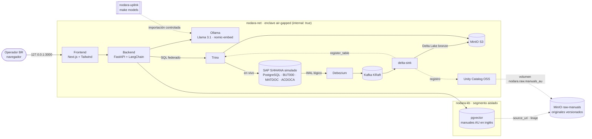

# Nodara BR-RAG

**Real-Time AI Lakehouse air-gapped para Inteligencia Operacional en minería multinacional (Australia → Brasil).**

Un operador de mantenimiento en Brasil pregunta en portugués. Un LLM local (Ollama) recupera los manuales técnicos en
inglés de las operaciones de Australia (pgvector), los traduce y los **cruza en tiempo real con SAP S/4HANA** (stock,
consumo y proveedores vía Trino) antes de responder. Todo ocurre dentro de un enclave **sin salida a Internet**.

| Indicador (validado con `make smoke` y `make ui-test`) | Resultado |
|---|---|
| Servicios del stack | 11 servicios `healthy` + 2 jobs de inicialización `exit 0` (arranque < 1 min con imágenes en caché) |
| Raw layer (gobierno de datos) | 8 originales versionados en `raw-manuals`, integridad SHA-256 y linaje índice ⊆ raw verificados |
| UI multiidioma | ES / EN / PT con persistencia del idioma, verificada con Playwright |
| Latencia CDC S/4 → Delta Lake (commit fuente → commit Delta) | 1–6 s medidos (micro-batch de 5 s, `FLUSH_INTERVAL_S`) |
| Federación Trino sobre S/4 en vivo | mismo conteo que el origen, sin copias |
| RAG E2E (Llama 3.1 8B en GPU GTX 1070 Ti) | ~28 s: traducción 1 s · retrieval 0,06 s · SAP vía Trino 0,6 s · generación 26 s |
| Air-gap | Ollama, backend, delta-sink y Kafka sin salida a Internet (con control positivo en la red edge) |
| Colisiones de puertos | 0 (`make preflight` revisa Linux/WSL y Windows) |

## Arquitectura



| Capa | Componente | Versión | Host (127.0.0.1) |
|---|---|---|---|
| Transaccional | SAP S/4HANA simulado — PostgreSQL relacional (`sap.but000`, `sap.matdoc`, `sap.acdoca`) | postgres 16.15 | `S4_DB_PORT` (5432) |
| CDC | Debezium Connect (pgoutput) + Kafka KRaft | 3.6.3 / 4.3.2 | Debezium REST 8083 |
| Lakehouse | MinIO (S3: `lakehouse` + `raw-manuals`) + Delta Lake (delta-rs) + Unity Catalog OSS + Trino | 2026-08 / 1.6 / 0.7.0 / 484 | MinIO 9000/9001 · UC 8081 · Trino 8080 |
| Conocimiento | PostgreSQL + pgvector aislado (solo manuales) | pgvector 0.8.7 | 5433 |
| IA y backend | FastAPI + LangChain → Ollama (Llama 3.1 8B, nomic-embed-text) | Ollama 0.40.11 | no publicado (air-gap) |
| Frontend | Next.js + TailwindCSS (consola del operador, ES/EN/PT) | Next 16.4 · Tailwind 4.3 | 3000 |

### Flujo de una pregunta

1. El operador pregunta en pt-BR desde el frontend; la petición llega al backend por el proxy interno.
2. El LLM local traduce la consulta al inglés técnico y `nomic-embed-text` la vectoriza.
3. pgvector (HNSW, coseno) devuelve los fragmentos de manual más relevantes y sus materiales SAP (`kb.part_xref`).
4. Trino consulta **en vivo** S/4HANA: stock por planta y depósito (MATDOC), consumo en órdenes (261) y proveedores (BUT000).
5. El LLM responde en pt-BR: traduce el procedimiento, cita las fuentes `[DOC-ID §sección]` y advierte si hay stock crítico.

### Pipeline en tiempo real

`S/4 (WAL) → Debezium → Kafka (s4hana.sap.*) → delta-sink → s3://lakehouse/bronze/<tabla>` (Delta, append-only con
`_cdc_op`, `_source_ts`, `_source_lsn`, `_ingested_at`). Cada tabla nueva se registra sola en Trino
(`lakehouse.bronze.*`) y en Unity Catalog (`nodara.bronze.*`). Para generar actividad: `make simulate n=10`.

### Raw layer (gobierno de datos)

Los manuales originales (`knowledge/raw-manuals/<origen>/*.md`, con front matter de metadatos) se persisten
físicamente en el bucket **`raw-manuals`** durante el arranque (`minio-init`):

- **Versionado** habilitado: cada cambio en un original conserva su historial.
- **Carga idempotente por contenido**: solo se sube un archivo si cambió su SHA-256, que queda como metadata del
  objeto junto con `Classification` y `Language`.
- **Catálogo**: cada origen se registra en Unity Catalog como volumen EXTERNAL (`nodara.raw.manuals_au`).
- **Linaje**: `kb.documents.source_uri` apunta al original y cada respuesta del RAG lo devuelve. `make smoke`
  verifica que cada fragmento indexado en pgvector exista literalmente en su original (índice ⊆ raw).

### Consola multiidioma

El header incluye un selector **ES / EN / PT** (React Context, sin dependencias). Cambia todos los textos estáticos,
actualiza `<html lang>` y recuerda la elección del operador. Las respuestas del LLM siguen en pt-BR (ver TD-013).

## Air-gap: diseño de redes

| Red | Tipo | Quién | Propósito |
|---|---|---|---|
| `nodara-net` | `internal: true` | todo el stack | plano de datos e IA; sin egress |
| `nodara-kb` | `internal: true` | backend + vector-db | base de conocimiento aislada del resto del enclave |
| `nodara-edge` | bridge | solo servicios con puerto publicado | acceso del operador y de operaciones (bind 127.0.0.1) |
| `nodara-uplink` | bridge | `ollama-bootstrap` (perfil) | única vía de entrada de modelos (`make models`) |

Docker no publica puertos en redes `internal`, así que solo los servicios operables se conectan además a
`nodara-edge`. **Ollama, el backend, Kafka y delta-sink nunca tocan `nodara-edge`**: el smoke test verifica que no
tienen salida a Internet. El backend no se publica; el operador entra únicamente por el frontend.
En Linux nativo, `nodara-edge` además corre sin NAT de salida (Docker Desktop ignora esa opción).

## Puesta en marcha

Requisitos: Docker Engine/Desktop con Compose v2, `make`, `curl`. Recursos recomendados: 8 vCPU y 16 GB de RAM.

```bash
make env        # crea .env desde .env.example con secretos aleatorios (nunca se versiona)
make preflight  # detecta colisiones de puertos (Linux/WSL + Windows); ajusta puertos en .env si hace falta
make up         # build + up del stack completo
make smoke      # QA E2E: salud, CDC→Delta, raw layer + linaje, federación, KB, IA y air-gap
make models     # importa Llama 3.1 + nomic-embed-text al enclave (uplink controlado, ~5 GB)
make embed      # vectoriza los manuales en pgvector
make ui-test    # QA de UI: selector ES/EN/PT con Playwright (imagen ~3,4 GB, perfil qa)
```

Consola del operador: <http://localhost:3000> · Trino UI: <http://localhost:8080> · MinIO: <http://localhost:9001>
· Unity Catalog API: <http://localhost:8081/api/2.1/unity-catalog/catalogs> · Debezium: <http://localhost:8083/connectors>

GPU NVIDIA (opcional): define `COMPOSE_FILE=docker-compose.yml:docker-compose.gpu.yml` en `.env`.

## Datos de simulación

- **S/4HANA (BR)**: company code BR01, plantas BR10 Carajás (PA) y BR20 Itabira (MG). BUT000 (proveedores,
  empleados), MATDOC (EM 101, transferencias 311, consumos 261) y ACDOCA derivado con determinación automática de
  cuentas (siempre cuadrado). El simulador `sap.simulate_activity(n)` genera consumos y reposiciones.
- **Manuales (AU)**: 8 documentos y 12 fragmentos en inglés (camión HT-400, molino SAG, correa CV-12, bomba de pulpa,
  pala ES-4100, LOTO, supresión de incendios). **Corpus sintético**: los valores técnicos son ficticios.

## Decisiones de arquitectura

| Decisión | Motivo |
|---|---|
| MinIO vía fork comunitario `pgsty/minio` | MinIO dejó de publicar imágenes oficiales en 2025 (Docker Hub y quay devuelven 404). |
| Doble registro de tablas: Trino (file metastore en MinIO) + Unity Catalog | Trino OSS no lee Delta desde Unity Catalog OSS: UC gobierna el catálogo y Trino ejecuta las consultas. |
| Bronze = changelog append-only, entrega *at-least-once* | Los offsets se confirman después del commit Delta; silver deduplica por `_source_lsn` + PK. |
| Secretos de Debezium con `EnvVarConfigProvider` | La contraseña nunca se guarda en el tópico `connect-configs`. |
| Roles de mínimo privilegio | `debezium` (replicación), `trino_ro` (lectura), service account S3 limitado al bucket `lakehouse`. |
| Kafka en KRaft (sin ZooKeeper) | Kafka 4.x eliminó ZooKeeper; hay un componente menos que operar. |
| Puertos parametrizados y `make preflight` | En hosts con PostgreSQL nativo (5432) basta cambiar `S4_DB_PORT` en `.env`. |

## Estructura

```
├── docker-compose.yml          # stack completo (redes air-gap, healthchecks, dependencias)
├── docker-compose.gpu.yml      # override opcional NVIDIA para Ollama
├── TECH_DEBT.md                # registro de deuda técnica (se actualiza cada iteración)
├── knowledge/raw-manuals/au/   # manuales originales (fuente del raw layer en MinIO)
├── init-scripts/
│   ├── s4hana/                 # roles, esquema SAP, seed, simulador y contrato CDC
│   └── vectordb/               # pgvector: documentos (source_uri), part_xref, fragmentos
├── cdc/                        # conector Debezium + registro idempotente
├── lakehouse/
│   ├── minio/                  # buckets lakehouse + raw-manuals, service account, volúmenes UC
│   ├── trino/catalog/          # catálogos lakehouse (Delta) y s4hana (PostgreSQL)
│   └── delta-sink/             # Kafka CDC → Delta Lake + registro Trino/UC
├── backend/                    # orquestador FastAPI + LangChain + Ollama
├── frontend/                   # consola Next.js + Tailwind (ES/EN/PT) + e2e Playwright
└── scripts/                    # init-env, preflight, smoke-test
```

## Roadmap

La deuda técnica priorizada vive en [TECH_DEBT.md](TECH_DEBT.md).

1. Capa silver/gold: `MERGE` del estado vigente de cada tabla y KPIs de mantenimiento (Trino CTAS sobre Delta).
2. Ingesta de manuales PDF (chunking + embeddings) desde el bucket `raw-manuals`, como fuente única (TD-011, TD-012).
3. Seguridad: autenticación en Trino y Unity Catalog, TLS interno y control de acceso por planta.
4. Observabilidad: métricas de lag CDC, latencia del RAG y evaluación de respuestas (golden set pt-BR). El modelo de
   8B todavía comete imprecisiones de traducción y de razonamiento sobre stock: las reglas de negocio (stock crítico)
   ya se calculan en código y se evaluará un modelo mayor o un fine-tuning de dominio.
